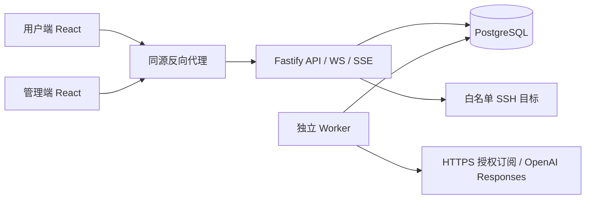

# 架构

Web 和 Admin 为独立 Vite + React 构建，各自 HTML / JS 入口，不把管理员页面打入用户端。控制台无需 SSR，选择 SPA 便于 20 人低成本独立静态部署。共享 UI 包只含展示组件、请求封装与设计 tokens。

API 是唯一业务入口。Cookie 身份、角色、对象 owner / grant、Origin / CSRF 均服务端强制执行。用户个人资源的管理员列表只含非敏感摘要，不提供他人秘密读取接口。

数据库使用 PostgreSQL 17，Drizzle schema 描述资源实体，业务查询主要采用 postgres.js 参数化 SQL，以便明确表达锁、JSONB、SKIP LOCKED 与原子事务。原始 SQL 和 Drizzle 使用独立连接池，避免 Drizzle JSON serializer 修改影响原始 SQL。迁移有版本表和事务 advisory lock。启动迁移服务与请求服务独立，不在 HTTP 请求中迁移。

实体覆盖总指令中的全部最低表；资源公共字段包括 UUID、owner FK、JSONB 验证数据、版本化加密 metadata、创建/更新时间与撤销时间。核心关联（节点源、AI 账户、SSH 服务器、资源授权）使用显式 FK 与索引。业务枚举由 Zod 约束。审计表通过数据库触发器拒绝 UPDATE / DELETE；数据库超级用户仍能绕过，生产必须分离迁移账号与运行账号。

任务使用 PostgreSQL 持久队列，SKIP LOCKED 领取，状态 QUEUED → RUNNING → COMPLETED / FAILED；失败指数退避，过期运行租约恢复。订阅每小时排程；Worker 独立部署，无 Redis。AI 输出持久化，SSE 每秒发送快照；没有终端输出持久化。当前单 Worker 适用于首期规模，任务会顺序执行；并发和预算在 API 限制。

各用户/账户没有共享 CLI home 或工作目录。GitHub 工作区字段仅为项目备注，不自动克隆仓库、读取文件或执行代码。未来 Provider Adapter 应维持现有 owner、预算、授权与审计边界。
