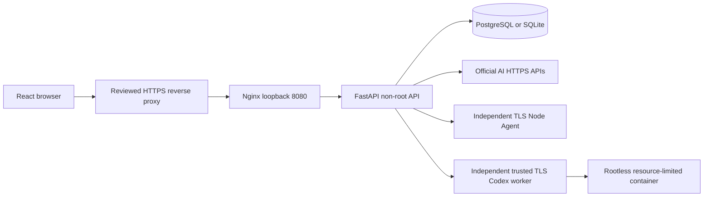

# 架构 / Architecture

v0.3 原始前端视觉令牌/CSS、React/Vite 架构和 FastAPI 技术栈得到保留；原单文件不安全会话实现拆分为 config、database、models、security、auth、admin、nodes、ai、codex 及适配器。原工程无业务数据或迁移文件，已加入 Alembic 和 legacy users 导入。

- `frontend/src/App.tsx`：权限导航、URL 守卫、可操作管理页面、表单/错误/空状态/确认弹窗/Toast。偏好存 localStorage，仅服务器 HttpOnly Cookie 存会话。没有前端持久化密码或 Key。
- `backend/app`：同步 SQLAlchemy 事务；服务启动验证安全配置和迁移版本，不会自动创建管理员。Web API 从不调用 shell 或 subprocess。
- `backend/migrations`：版本化 schema。用户角色外键指向 roles；session/token/资源外键；邮箱唯一、预算非负、任务时限约束。SQLite 启用 FK。PostgreSQL 是 Compose 默认。
- `security_lock`：在 SQLite 获取写锁、PostgreSQL 获取行锁，序列化首次管理员创建、最后管理员保护、预算预留和队列领取，避免并发绕过。
- 会话：随机 48-byte URL-safe token；DB 只存 SHA256 digest。每请求核实用户 active 和当前权限；退出/密码重置/权限更新撤销数据库会话。持有旧 Cookie 无法复活。
- CSRF：所有非安全方法要求 HMAC 签名随机 Cookie 和匹配请求头；有 Origin 时必须匹配 PUBLIC_ORIGIN。Google callback 使用绑定浏览器 Cookie 的一次性 state + nonce + PKCE。
- AI：硬编码官方 API host，无任意 endpoint/SSRF 配置；用户显式选择授权账户/模型。Key 在只读 secret 文件中，仅服务端读取。请求内容不持久化；用量仅采纳供应商返回值，未知保持 null。并发调用前锁内预算预留，失败未知保留，避免超额并发；本地估算不是供应商账单。
- 节点：Web 中只存授权引用和状态；独立 Agent 拥有配置目录写权限及官方引擎 CLI 验证权限，没有 root/systemctl/shell。遥测带作用域，不将 Agent 指标当作整机指标。
- Codex：API 仅 HTTPS 调用外部 worker；状态和审批持久化，提交幂等键。外部 worker 必须执行硬资源限制、仓库白名单和安全隔离；参考启动器无生产授权。API 定期协调排队任务，当前全局串行，不是高吞吐分布式调度器。
- 运维：真实 DB 健康、任务汇总、节点错误；备份由独立脚本和运维计划执行。日志只记录请求 ID、方法、路径（无 query）、状态、耗时、错误类型，不记录密码、Cookie、令牌、提示词或响应。

边界：真实 Node reload、Codex worker 服务、完整主机监控、供应商余额和外部告警渠道尚未提供。详见集成状态。不要将该交付描述为已完成外部生产集成。
